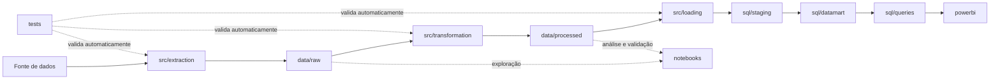

# Estrutura física do projeto

Este documento é o guia oficial para decidir **onde cada arquivo deve ficar** no repositório **BI Eleições 2020 — São Paulo**. Ele foi elaborado a partir da estrutura real existente na `main`.

O arquivo [arquitetura.md](arquitetura.md) apresenta a arquitetura técnica e conceitual do sistema. Este documento é complementar: explica a organização física do repositório, o conteúdo esperado em cada diretório e como escolher o local de um novo arquivo.

> **Estado atual:** o repositório contém a estrutura inicial e sua documentação. Os diretórios de dados, código, SQL, notebooks, testes e Power BI ainda são mantidos principalmente por arquivos `.gitkeep`. Os nomes de scripts, datasets, notebooks e artefatos apresentados abaixo são **exemplos**, não arquivos já implementados.

## Visão geral da arquitetura

O projeto segue uma organização voltada a Business Intelligence e Engenharia de Dados. Cada etapa possui uma responsabilidade própria:

```text
Extração
   ↓
Dados brutos
   ↓
Transformação
   ↓
Dados processados
   ↓
Carregamento no banco
   ↓
Staging
   ↓
Data Mart
   ↓
Consultas
   ↓
Power BI
```

O caminho físico esperado é:

```text
Fonte de dados
→ src/extraction/
→ data/raw/
→ src/transformation/
→ data/processed/
→ src/loading/
→ sql/staging/
→ sql/datamart/
→ sql/queries/
→ powerbi/
```

Em termos simples:

- **extraction** pega o dado da fonte;
- **raw** preserva a cópia original;
- **transformation** limpa e aplica regras;
- **processed** armazena o resultado tratado;
- **loading** grava os dados no destino, como PostgreSQL;
- **staging** recebe e prepara os dados no banco;
- **datamart** organiza fatos e dimensões para análise;
- **queries** contém consultas de validação e indicadores;
- **powerbi** apresenta os resultados em dashboards.

Esse fluxo é uma separação de responsabilidades. Conforme a implementação evoluir, uma execução pode carregar dados diretamente do arquivo processado para a staging ou executar parte da transformação no banco, desde que os arquivos continuem organizados conforme sua finalidade.

## Relação entre as pastas



## Árvore real do repositório

A árvore abaixo representa os arquivos e diretórios versionados no momento da criação deste guia:

```text
BI Eleições 2020 — São Paulo/
├── .github/
│   └── pull_request_template.md
├── data/
│   ├── processed/
│   │   └── .gitkeep
│   └── raw/
│       └── .gitkeep
├── docs/
│   ├── arquitetura.md
│   ├── cronograma-sprints.md
│   ├── equipe.md
│   ├── estrutura-projeto.md
│   ├── fluxo-git-jira.md
│   ├── guia-equipe.md
│   ├── guia-git-pratico.md
│   └── padrao-git.md
├── notebooks/
│   └── .gitkeep
├── powerbi/
│   └── .gitkeep
├── sql/
│   ├── datamart/
│   │   └── .gitkeep
│   ├── queries/
│   │   └── .gitkeep
│   └── staging/
│       └── .gitkeep
├── src/
│   ├── extraction/
│   │   └── .gitkeep
│   ├── loading/
│   │   └── .gitkeep
│   └── transformation/
│       └── .gitkeep
├── tests/
│   └── .gitkeep
├── .gitignore
├── CONTRIBUTING.md
├── README.md
└── requirements.txt
```

O `.gitkeep` é apenas um arquivo vazio usado para manter diretórios ainda sem conteúdo no Git. Ele pode deixar de ser necessário quando o diretório receber arquivos versionáveis.

## Diretórios do projeto

### `.github/`

**Objetivo**

Armazenar configurações e modelos usados pelo GitHub.

**O que colocar aqui**

- templates e configurações relacionadas ao funcionamento do repositório no GitHub;
- neste projeto, `pull_request_template.md`, que orienta o preenchimento de Pull Requests com issue Jira, descrição, alterações, teste, critérios de aceitação, evidências, observações e revisão.

**Exemplos**

```text
.github/
└── pull_request_template.md  # arquivo real
```

**Não colocar aqui**

- código Python;
- scripts SQL;
- datasets;
- notebooks;
- documentação geral do projeto, que deve ir para `docs/`.

### `data/`

**Objetivo**

Agrupar os dados locais utilizados e produzidos pelo pipeline, separando arquivos originais de arquivos tratados.

**O que colocar aqui**

- dados originais em `data/raw/`;
- dados transformados em `data/processed/`.

**Exemplos**

```text
data/
├── raw/
└── processed/
```

**Não colocar aqui**

- scripts Python;
- consultas SQL;
- dashboards Power BI;
- documentação geral.

> O `.gitignore` atual mantém datasets de `data/raw/` e `data/processed/` fora do Git. As pastas existem no repositório, mas seus dados devem permanecer locais, salvo decisão específica da equipe.

### `data/raw/`

**Objetivo**

Armazenar cópias **originais e imutáveis** dos dados obtidos das fontes. O conteúdo deve permanecer o mais próximo possível do arquivo fornecido pelo TSE ou por outra fonte.

**O que colocar aqui**

- arquivos baixados sem tratamento manual;
- formatos de origem como `.csv`, `.xlsx`, `.json` ou `.parquet`;
- arquivos necessários para reproduzir a transformação local, respeitando o `.gitignore`.

**Exemplos**

Os nomes abaixo são exemplos:

```text
data/raw/
├── candidatos_2020.csv
├── votacao_secao_2020.csv
├── resultados_2020.csv
└── municipios.csv
```

**Não colocar aqui**

- arquivos limpos ou normalizados;
- resultados de agregações;
- dados editados manualmente;
- scripts de download ou transformação.

Fluxo correto:

```text
data/raw/candidatos.csv
        ↓
script em src/transformation/
        ↓
data/processed/candidatos_tratados.csv
```

Fluxo incorreto:

```text
baixar candidatos.csv
→ editar células manualmente
→ sobrescrever o arquivo em data/raw/
```

Se a fonte publicar uma nova versão, preserve a rastreabilidade com um nome ou organização definida pela equipe; não altere silenciosamente o conteúdo original.

### `data/processed/`

**Objetivo**

Armazenar dados gerados pelo processo de transformação e preparados para análise, carregamento ou consumo por outra etapa.

**O que colocar aqui**

- dados limpos e tratados;
- dados normalizados e com tipos corrigidos;
- dados sem duplicidades indevidas;
- dados enriquecidos ou agregados;
- saídas reproduzíveis de scripts em `src/transformation/`.

**Exemplos**

Os nomes abaixo são exemplos:

```text
data/processed/
├── candidatos_tratados.csv
├── votacao_tratada.parquet
└── resultado_por_municipio.csv
```

**Não colocar aqui**

- cópias originais sem tratamento, que pertencem a `data/raw/`;
- scripts que produzem os dados;
- arquivos criados manualmente sem processo reproduzível;
- consultas SQL ou dashboards.

### `src/`

**Objetivo**

Concentrar o código-fonte oficial e reproduzível do pipeline de dados.

**O que colocar aqui**

- código Python de extração, transformação e carga;
- módulos reutilizáveis ligados à execução do pipeline;
- regras que deixaram de ser apenas experimentais.

**Exemplos**

```text
src/
├── extraction/
├── transformation/
└── loading/
```

**Não colocar aqui**

- datasets CSV ou Parquet;
- notebooks exploratórios;
- scripts SQL;
- testes automatizados;
- arquivos `.pbix`.

### `src/extraction/`

**Objetivo**

Obter dados de fontes externas. **Extraction = pegar o dado.**

**O que colocar aqui**

- scripts para baixar arquivos do TSE;
- clientes de APIs;
- leitura ou exportação de fontes públicas, CSV, Excel ou bancos externos;
- validações mínimas necessárias para garantir que o download ocorreu corretamente.

**Exemplos**

Os nomes abaixo são exemplos:

```text
src/extraction/
├── extrair_candidatos.py
├── extrair_votacao.py
└── baixar_dados_tse.py
```

**Não colocar aqui**

- regras principais de limpeza e negócio;
- criação de indicadores;
- carregamento no banco;
- arquivos baixados, que pertencem a `data/raw/`.

### `src/transformation/`

**Objetivo**

Aplicar limpeza, padronização e regras aos dados. **Transformation = transformar o dado.**

**O que colocar aqui**

- conversão de tipos;
- tratamento de valores nulos;
- remoção controlada de duplicidades;
- padronização de nomes, códigos e municípios;
- criação de colunas derivadas;
- aplicação de regras de negócio;
- geração reproduzível de arquivos em `data/processed/`.

**Exemplos**

Os nomes abaixo são exemplos:

```text
src/transformation/
├── tratar_candidatos.py
├── tratar_votacao.py
├── normalizar_municipios.py
└── transformar_resultados.py
```

**Não colocar aqui**

- código cuja responsabilidade é somente baixar o dado;
- código de conexão e gravação no destino;
- arquivos processados gerados;
- experimentos que ainda pertencem a notebooks.

### `src/loading/`

**Objetivo**

Carregar dados no destino. **Loading = gravar ou carregar o dado.**

**O que colocar aqui**

- conexão controlada com o PostgreSQL previsto na arquitetura;
- inserção ou atualização de dados na staging e no Data Mart;
- rotinas de carga idempotente quando aplicável;
- validações relacionadas ao sucesso da gravação.

**Exemplos**

Os nomes abaixo são exemplos:

```text
src/loading/
├── carregar_staging.py
├── carregar_candidatos.py
└── carregar_resultados.py
```

**Não colocar aqui**

- credenciais ou senhas no código;
- regras extensas de limpeza que pertencem a `src/transformation/`;
- definições SQL da estrutura do banco;
- datasets.

### `sql/`

**Objetivo**

Reunir os scripts SQL do projeto e separá-los por função no fluxo de dados.

**O que colocar aqui**

- definição e preparação da staging;
- modelagem analítica do Data Mart;
- consultas de análise, validação e indicadores.

**Exemplos**

```text
sql/
├── staging/
├── datamart/
└── queries/
```

**Não colocar aqui**

- código Python;
- datasets;
- notebooks;
- arquivos do Power BI.

### `sql/staging/`

**Objetivo**

Definir e preparar a camada intermediária que recebe dados antes da modelagem analítica final.

**O que colocar aqui**

- comandos `CREATE TABLE` da staging;
- estruturas temporárias ou intermediárias persistentes;
- scripts de limpeza e preparação no banco;
- comandos necessários ao ETL/ELT antes do Data Mart.

**Exemplos**

Os nomes abaixo são exemplos:

```text
sql/staging/
├── create_stg_candidatos.sql
├── create_stg_votacao.sql
└── limpar_staging.sql
```

**Não colocar aqui**

- dimensões e fatos finais;
- consultas analíticas de indicadores;
- scripts Python de carga;
- dashboards.

### `sql/datamart/`

**Objetivo**

Definir a estrutura analítica consumida pelo BI, incluindo o modelo dimensional.

**O que colocar aqui**

- dimensões, que descrevem entidades como candidato, partido, município e tempo;
- fatos, que armazenam eventos, chaves e métricas como quantidade de votos;
- relacionamentos, restrições e views da camada analítica;
- scripts de criação e manutenção do modelo estrela.

**Exemplos**

Os nomes abaixo são exemplos:

```text
sql/datamart/
├── dim_candidato.sql
├── dim_partido.sql
├── dim_municipio.sql
├── dim_tempo.sql
└── fato_votacao.sql
```

**Não colocar aqui**

- tabelas intermediárias de recebimento;
- consultas avulsas de indicadores;
- scripts Python;
- arquivos de dados.

### `sql/queries/`

**Objetivo**

Armazenar consultas usadas para análise, conferência, validação, indicadores e apoio ao Power BI.

**O que colocar aqui**

- consultas `SELECT` de negócio;
- verificações de qualidade e consistência;
- consultas de indicadores;
- consultas reutilizadas para validar valores do dashboard.

**Exemplos**

Os nomes abaixo são exemplos:

```text
sql/queries/
├── votos_por_partido.sql
├── votos_por_municipio.sql
├── candidatos_eleitos.sql
└── ranking_candidatos.sql
```

**Não colocar aqui**

- criação de dimensões ou fatos;
- criação da camada staging;
- código Python;
- resultados exportados das consultas.

### `notebooks/`

**Objetivo**

Armazenar Jupyter Notebooks de exploração, experimentação e análise interativa.

**O que colocar aqui**

- exploração inicial dos dados;
- análise descritiva;
- testes exploratórios de hipóteses;
- validações visuais;
- gráficos temporários;
- protótipos de transformações.

**Exemplos**

Os nomes abaixo são exemplos:

```text
notebooks/
├── 01_exploracao_candidatos.ipynb
├── 02_analise_votacao.ipynb
└── 03_validacao_dados.ipynb
```

**Não colocar aqui**

- a única implementação de uma regra oficial do pipeline;
- credenciais;
- datasets grandes incorporados ao notebook;
- testes automatizados permanentes.

Quando uma transformação explorada no notebook se tornar parte oficial do processo, mova sua implementação reproduzível para `src/transformation/`. O notebook pode permanecer como análise e evidência, mas não deve ser o único lugar onde a regra existe.

### `powerbi/`

**Objetivo**

Agrupar artefatos diretamente relacionados ao dashboard e ao modelo do Power BI.

**O que colocar aqui**

- arquivos `.pbix` ou `.pbit` quando a estratégia de versionamento da equipe permitir;
- documentação específica do modelo Power BI;
- recursos diretamente ligados ao relatório, quando pequenos e autorizados.

**Exemplos**

Os nomes abaixo são exemplos:

```text
powerbi/
├── eleicoes_sp_2020.pbix
└── README.md
```

No futuro, se o volume de artefatos justificar, a equipe pode avaliar subpastas como `reports/`, `assets/` e `documentation/`. Elas **não existem atualmente** e não foram criadas por este documento.

**Não colocar aqui**

- CSV bruto ou tratado;
- scripts Python;
- SQL de criação do banco;
- documentação geral do projeto.

> Atenção: o `.gitignore` atual ignora `*.pbix` e `*.pbit`. Portanto, esses arquivos podem ser mantidos localmente em `powerbi/`, mas não serão versionados enquanto essa regra permanecer. Qualquer mudança nessa política deve ser decidida pela equipe em tarefa própria.

### `tests/`

**Objetivo**

Armazenar testes automatizados que validam o comportamento do pipeline e a qualidade esperada dos dados.

**O que colocar aqui**

- testes de extração, transformação e carga;
- validação de campos obrigatórios e tipos;
- verificação de quantidade mínima de registros;
- regras sobre nulos e duplicidades;
- testes de integridade e regras de transformação;
- testes de carregamento no banco.

**Exemplos**

Os nomes abaixo são exemplos:

```text
tests/
├── test_extraction.py
├── test_transformation.py
└── test_loading.py
```

**Não colocar aqui**

- scripts executados diretamente para produzir dados;
- notebooks exploratórios;
- datasets completos;
- código de produção que pertence a `src/`.

### `docs/`

**Objetivo**

Concentrar a documentação técnica, organizacional e operacional do projeto.

**O que colocar aqui**

- guias para a equipe;
- decisões e descrições arquiteturais;
- cronogramas e documentação de processos;
- instruções de uso e organização.

**Arquivos reais e finalidade**

| Arquivo | Finalidade observada |
|---|---|
| `arquitetura.md` | Apresenta a arquitetura conceitual prevista, do Portal TSE até dashboard e storytelling, e as responsabilidades de RAW, Python/Pandas, staging, PostgreSQL, ETL e Data Mart. |
| `cronograma-sprints.md` | Registra o planejamento das Sprints semanais, seus temas e períodos. |
| `equipe.md` | Documenta integrantes, papéis, responsabilidades, ferramentas da equipe, fluxo resumido de trabalho e padrão de branch. |
| `fluxo-git-jira.md` | Define o fluxo oficial entre Jira, branches, commits, Pull Requests, revisão independente, autorização de merge e conclusão. |
| `guia-equipe.md` | Oferece uma versão curta do fluxo para quem está começando, com comandos principais e regra de merge. |
| `guia-git-pratico.md` | Ensina passo a passo os comandos Git usados do início da tarefa até a PR e as correções de revisão. |
| `padrao-git.md` | Resume os padrões de branch, mensagens de commit e Pull Requests. |
| `estrutura-projeto.md` | Explica a organização física do repositório e ajuda a decidir onde criar cada arquivo. |

**Exemplos**

```text
docs/
├── arquitetura.md
├── estrutura-projeto.md
└── nome-do-novo-guia.md
```

**Não colocar aqui**

- código executável do pipeline;
- datasets;
- notebooks;
- scripts SQL;
- arquivos do dashboard.

## Arquivos da raiz

### `README.md`

**Objetivo**

Ser a visão geral e o primeiro arquivo lido por quem chega ao projeto.

**O que colocar aqui**

- objetivo do projeto;
- fonte dos dados;
- tecnologias principais;
- resumo da estrutura;
- links para documentação detalhada.

**Exemplos**

- link para o fluxo de contribuição;
- link para este guia;
- instruções essenciais de entrada no projeto.

**Não colocar aqui**

- manuais extensos já mantidos em `docs/`;
- código do pipeline;
- datasets ou credenciais.

### `CONTRIBUTING.md`

**Objetivo**

Definir as regras para contribuir com o projeto.

**O que colocar aqui**

- fluxo resumido Jira e GitHub;
- padrão de branches e commits;
- requisitos de revisão e autorização do merge;
- referências para guias detalhados.

**Exemplos**

- regra `AUTOR != REVISOR`;
- formato `ELEICOES-XX: descrição`;
- obrigação de trabalhar em branch própria.

**Não colocar aqui**

- implementação do pipeline;
- descrição detalhada de cada dataset;
- dependências Python.

### `requirements.txt`

**Objetivo**

Declarar as dependências Python controladas do projeto.

**O que colocar aqui**

Somente dependências necessárias ao ambiente Python. Atualmente o arquivo real contém:

```text
numpy>=2.0,<3.0
pandas>=2.2,<3.0
jupyterlab>=4.0,<5.0
psycopg[binary]>=3.2,<4.0
```

**Exemplos**

- NumPy e Pandas para análise e transformação;
- JupyterLab para notebooks;
- Psycopg para integração prevista com PostgreSQL.

**Não colocar aqui**

- código Python;
- comandos SQL;
- credenciais de banco;
- dependências não utilizadas apenas “por precaução”.

### `.gitignore`

**Objetivo**

Definir arquivos e diretórios que o Git não deve versionar.

**O que colocar aqui**

- padrões para segredos e ambientes locais;
- caches e artefatos gerados;
- datasets locais;
- arquivos de banco e logs;
- configurações locais de IDE;
- artefatos Power BI que a política atual mantém fora do Git.

**Exemplos reais**

```text
.env
.venv/
__pycache__/
data/raw/*
data/processed/*
*.pbix
*.pbit
```

**Não colocar aqui**

- regras que escondam código-fonte necessário ao projeto;
- segredos reais;
- documentação sobre como executar o pipeline.

## Exemplo completo do fluxo de dados

O cenário a seguir é um **exemplo de organização futura**. Os nomes citados não representam arquivos já existentes.

Precisamos utilizar os dados de candidatos das Eleições 2020:

1. `src/extraction/extrair_candidatos.py` baixa os dados da fonte oficial.
2. `data/raw/candidatos_2020.csv` recebe a cópia original sem edição manual.
3. `src/transformation/tratar_candidatos.py` limpa, tipa e padroniza os registros.
4. `data/processed/candidatos_tratados.csv` recebe a saída reproduzível da transformação.
5. `src/loading/carregar_candidatos.py` carrega os dados no PostgreSQL.
6. Scripts em `sql/staging/` definem ou preparam a camada intermediária.
7. Scripts em `sql/datamart/` organizam dimensões e fatos para análise.
8. Consultas em `sql/queries/` calculam ou validam indicadores.
9. O conteúdo de `powerbi/` consome a camada analítica e apresenta o dashboard.

Representação resumida:

```text
src/extraction/extrair_candidatos.py
        ↓
data/raw/candidatos_2020.csv
        ↓
src/transformation/tratar_candidatos.py
        ↓
data/processed/candidatos_tratados.csv
        ↓
src/loading/carregar_candidatos.py
        ↓
sql/staging/
        ↓
sql/datamart/
        ↓
sql/queries/
        ↓
powerbi/
```

Quando arquivos reais forem implementados, use os nomes e contratos definidos nessas implementações em vez de copiar automaticamente os nomes do exemplo.

## Onde colocar?

| Quero criar... | Onde colocar |
|---|---|
| Script para baixar dados | `src/extraction/` |
| Cliente de uma API de origem | `src/extraction/` |
| Arquivo original baixado | `data/raw/` |
| Script para limpar ou padronizar dados | `src/transformation/` |
| Regra oficial de transformação | `src/transformation/` |
| Arquivo já tratado | `data/processed/` |
| Script para inserir dados no banco | `src/loading/` |
| SQL da camada intermediária | `sql/staging/` |
| Dimensão, fato ou modelagem estrela | `sql/datamart/` |
| Consulta de indicador ou validação | `sql/queries/` |
| Análise exploratória ou experimento | `notebooks/` |
| Dashboard ou artefato Power BI | `powerbi/` |
| Teste automatizado | `tests/` |
| Documentação técnica ou operacional | `docs/` |
| Visão inicial do projeto | `README.md` |
| Regra de contribuição | `CONTRIBUTING.md` |
| Dependência Python | `requirements.txt` |
| Template de Pull Request | `.github/` |

## Estou criando um arquivo novo. Onde ele vai?

Use esta sequência de decisão:

```text
O arquivo baixa ou obtém dados?
→ src/extraction/

O arquivo transforma, limpa ou aplica regra de negócio?
→ src/transformation/

O arquivo carrega ou grava dados em um destino?
→ src/loading/

É um dado original, sem transformação manual?
→ data/raw/

É um dado tratado e reproduzível?
→ data/processed/

Cria ou prepara a camada intermediária no banco?
→ sql/staging/

Cria fato, dimensão ou modelo analítico?
→ sql/datamart/

É somente uma consulta, validação ou indicador?
→ sql/queries/

É exploração, hipótese ou experimento?
→ notebooks/

É diretamente ligado ao Power BI?
→ powerbi/

É validação automatizada?
→ tests/

Explica como ou por que o projeto funciona?
→ docs/

Configura o comportamento do repositório no GitHub?
→ .github/
```

Se um arquivo parece pertencer a duas pastas, identifique sua **responsabilidade principal**. Por exemplo, um script Python que executa uma consulta e grava os resultados no banco é código de carga em `src/loading/`; o SQL reutilizável que ele executa pode ficar na subpasta SQL correspondente.

## Regras de organização

1. Não coloque scripts Python soltos na raiz.
2. Não coloque CSV, Excel, JSON ou Parquet dentro de `src/`.
3. Não coloque dados brutos em `data/processed/`.
4. Não altere manualmente arquivos de `data/raw/`.
5. Não coloque queries analíticas dentro de `sql/staging/`.
6. Não coloque arquivos `.pbix` em `data/`.
7. Não use `notebooks/` como substituto permanente de `src/`.
8. Todo código usado oficialmente pelo pipeline deve ter implementação reproduzível em `src/`.
9. Novos documentos devem ir para `docs/`, exceto `README.md` e `CONTRIBUTING.md`, que permanecem na raiz.
10. Testes automatizados devem ficar em `tests/`.
11. Use nomes claros e, preferencialmente, `snake_case` para arquivos Python e SQL.
12. Não misture scripts de criação do Data Mart com consultas de indicadores.
13. Não versione credenciais, tokens, senhas ou arquivos `.env`.
14. Respeite o `.gitignore`: datasets e artefatos Power BI estão fora do versionamento na política atual.
15. Identifique explicitamente exemplos de estruturas futuras; não apresente caminhos inexistentes como já implementados.

Exemplo de nome claro:

```text
tratar_candidatos.py
```

Exemplo de nome que deve ser evitado:

```text
testeNovoFinal2.py
```

## Documentação versus implementação

| Local | Responsabilidade |
|---|---|
| `docs/` | Explica **como** e **por que** o projeto funciona. |
| `src/` | Implementa o pipeline em Python. |
| `sql/` | Implementa estruturas e análises SQL. |
| `data/` | Contém entradas originais e saídas tratadas locais. |
| `powerbi/` | Contém a camada de visualização e seus artefatos. |
| `tests/` | Faz validação automática do comportamento e dos dados. |
| `notebooks/` | Permite exploração, análise interativa e experimentação. |

Uma explicação sobre uma regra pertence a `docs/`; o código que executa essa regra pertence a `src/`; o teste que comprova a regra pertence a `tests/`.

## Checklist antes de criar um arquivo

Antes de adicionar qualquer arquivo, responda:

1. Qual é a responsabilidade principal deste arquivo?
2. Ele é código, dado, SQL, análise exploratória, teste, visualização ou documentação?
3. Existe uma pasta específica para essa responsabilidade?
4. O nome explica claramente seu conteúdo?
5. O arquivo contém credenciais ou dados que o `.gitignore` deve proteger?
6. Ele duplica uma implementação ou documentação existente?
7. Se é um experimento aprovado, precisa ser convertido em código oficial em `src/`?

Se ainda houver dúvida, consulte este guia e [arquitetura.md](arquitetura.md) ou peça orientação ao responsável técnico antes de criar o arquivo em uma pasta genérica.